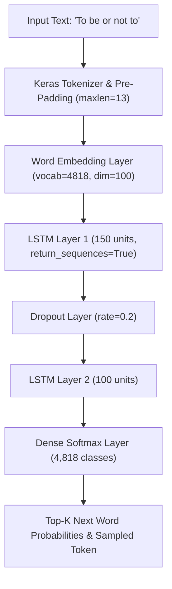
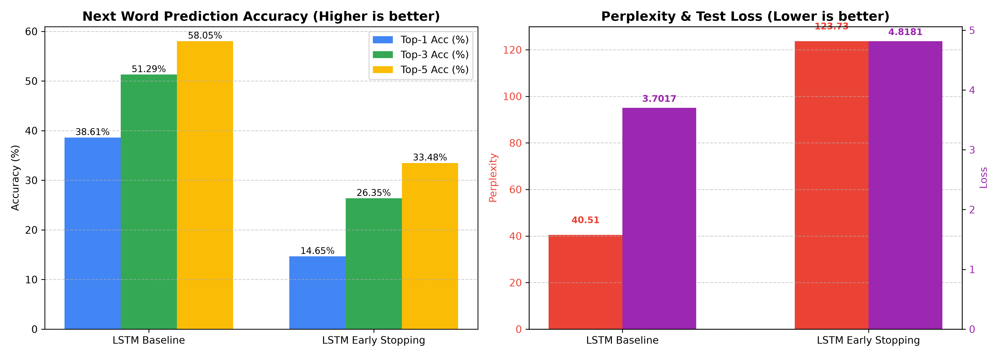

# 📖 Shakespearean Next Word Prediction (LSTM & GRU)

[](https://www.python.org/)
[](https://www.tensorflow.org/)
[](https://streamlit.io/)

A deep learning Natural Language Processing (NLP) system that performs **next-word prediction and text continuation** trained on Shakespeare's masterpiece *Hamlet*. The project features deep Recurrent Neural Network (LSTM/GRU) models, an automated quantitative evaluation pipeline, and an interactive **Streamlit web application**.

---

## 🚀 Key Features

* **Dual Model Checkpoints**:
  * **Baseline LSTM**: Fully converged recurrent model achieving lower perplexity and higher autocomplete accuracy.
  * **Early Stopping LSTM**: Regularized model checkpointed via validation loss monitoring.
* **Interactive Streamlit Web Interface**:
  * Real-time next-word autocomplete suggestions with confidence rankings.
  * Top-K candidate word visualization with probability distribution charts.
  * Multi-word sequence generation with adjustable **sampling temperature**.
  * Pre-configured Shakespearean sample prompts.
* **Rigorous Evaluation Pipeline (`evaluate.py`)**:
  * Computes **Cross-Entropy Loss**, **Perplexity ($e^{\text{loss}}$)**, and **Top-1 / Top-3 / Top-5 / Top-10 Categorical Accuracy**.
  * Evaluates on an independent test split (5,147 N-gram sequences).

---

## 🧠 Model Architecture

The model processes text sequences tokenized from Shakespeare's *Hamlet* using an N-gram sliding window of maximum sequence length 14.



---

## 📊 Benchmark & Evaluation Metrics

The models were quantitatively evaluated using an 80/20 train-test split over **25,732 N-gram sequences** (5,147 test samples):

| Model Architecture | Cross-Entropy Loss ↓ | Perplexity (PPL) ↓ | Top-1 Accuracy ↑ | Top-3 Accuracy ↑ | Top-5 Accuracy ↑ | Top-10 Accuracy ↑ |
| :--- | :---: | :---: | :---: | :---: | :---: | :---: |
| **LSTM Baseline (`next_word_lstm.h5`)** | **3.7017** | **40.51** | **38.61%** | **51.29%** | **58.05%** | **66.54%** |
| **LSTM Early Stopping (`early_stopping.h5`)** | 4.8181 | 123.73 | 14.65% | 26.35% | 33.48% | 44.82% |

> **Key Finding**: The fully trained baseline model outperforms the early stopping checkpoint, achieving a **58.05% Top-5 accuracy** and **40.51 Perplexity** on Shakespearean vocabulary.

### Visual Comparison



---

## 📁 Repository Structure

```text
├── app.py                                       # Streamlit web application
├── evaluate.py                                  # Standalone quantitative evaluation script
├── evaluation_metrics.json                      # Exported test metrics
├── evaluation_metrics.png                       # Performance comparison chart
├── experiments.ipynb                            # Training, preprocessing & model exploration
├── hamlet.txt                                   # Corpus dataset (Shakespeare's Hamlet)
├── next_word_lstm.h5                            # Trained baseline LSTM model weights
├── next_word_lstm_model_with_early_stopping.h5  # Trained early-stopping LSTM weights
├── tokenizer.pickle                             # Fitted Keras word tokenizer
├── requirements.txt                             # Python dependencies
├── .gitignore                                   # Ignored files (venv, cache, etc.)
└── README.md                                    # Project documentation
```

---

## 🛠️ Setup & Installation

### 1. Clone the Repository
```bash
git clone https://github.com/<your-username>/lstm-next-word-prediction.git
cd lstm-next-word-prediction
```

### 2. Create and Activate a Virtual Environment
```bash
# Windows
python -m venv .venv
.\.venv\Scripts\activate

# macOS / Linux
python3 -m venv .venv
source .venv/bin/activate
```

### 3. Install Dependencies
```bash
pip install -r requirements.txt
```

---

## 💻 Running the Application

Launch the Streamlit web interface:
```bash
streamlit run app.py
```
Open [http://localhost:8501](http://localhost:8501) in your browser.

---

## 📈 Reproducing Evaluation Metrics

To recompute metrics and regenerate the comparison plots:
```bash
python evaluate.py
```
This will evaluate both `.h5` model files on the test split, update `evaluation_metrics.json`, and refresh `evaluation_metrics.png`.
